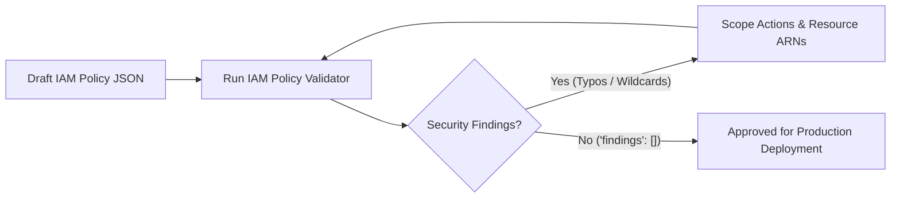

# Lab 01: Refining IAM Permissions Like A Pro

**Role:** Chief Cloud Architect  
**Focus:** Least Privilege Enforcement, IAM Policy Validation, & Finding Remediation  

---

## 📌 Lab Objective
Hands-on execution of AWS IAM Access Analyzer policy validation to detect invalid actions (typos like `s3:GetObjct`) and overly permissive wildcards (`s3:*` or `*`), followed by structured remediation to achieve a zero-finding baseline (`"findings": []`).

---

## 🔄 Policy Validation & Remediation Workflow

---

## 🛡️ Security Remediation Comparison

| Security Defect | Vulnerable Configuration | Remediated Least-Privilege Configuration |
| :--- | :--- | :--- |
| **Invalid API Action** | `"Action": ["s3:GetObjct"]` (Syntax/Typo Error) | `"Action": ["s3:GetObject"]` (Verified AWS API Action) |
| **Action Wildcard** | `"Action": ["s3:*"]` (Overly Permissive) | `"Action": ["s3:GetObject", "s3:PutObject"]` (Scoped Actions) |
| **Resource Wildcard** | `"Resource": "*"` (Unrestricted Blast Radius) | `"Resource": "arn:aws:s3:::secure-portfolio-bucket/*"` (Specific ARN) |

---

## 🧪 Automated Policy Validator (`Python`)
This folder includes a standalone validation script (`iam_policy_validator.py`) that programmatically audits IAM JSON statements for action typos and wildcard violations before deployment.

