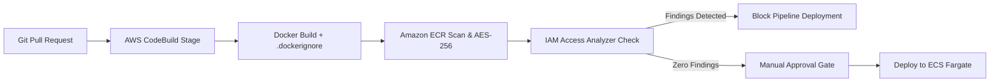

# Lab 02: Integrating IAM Access Analyzer into CI/CD Pipelines

**Role:** Chief Cloud Architect  
**Focus:** DevSecOps Automation, Container Supply Chain Security, & Automated Policy Guardrails  

---

## 📌 Lab Objective
Embed automated AWS IAM Access Analyzer policy checks (`CheckAccessNotGranted`, `ValidatePolicy`) directly inside AWS CodeBuild CI/CD pipelines to block overly permissive wildcards (`*`) and privilege escalation before production deployment to Amazon ECS Fargate.

---

## 🔄 DevSecOps CI/CD Security Gate Pipeline

---

## 🛡️ CI/CD Security Guardrails & Controls

| Pipeline Stage | Security Control Implemented | Risk Mitigated |
| :--- | :--- | :--- |
| **Source & Build** | `.dockerignore` secret filtering & `cfn-lint` static analysis | Prevents credential leakage and malformed IaC templates |
| **Container Registry** | Amazon ECR AES-256 Encryption, Tag Immutability, & CVE Scanning | Blocks tampered container images and known OS vulnerabilities |
| **Policy Gatekeeper** | Automated `pytest` & IAM Access Analyzer `CheckAccessNotGranted` | Halts deployment if policies grant `*` wildcards or privilege escalation |
| **Release Governance** | Mandatory Git Pull Request & Manual Approval Gate | Enforces human-in-the-loop verification prior to ECS Fargate rollout |

---

## 🧪 Automated CI/CD Security Gate (`Python`)
This folder includes a standalone gatekeeper script (`cicd_security_gate.py`) that simulates automated CI/CD checks for container scanning and IAM policy compliance before Fargate deployment.
