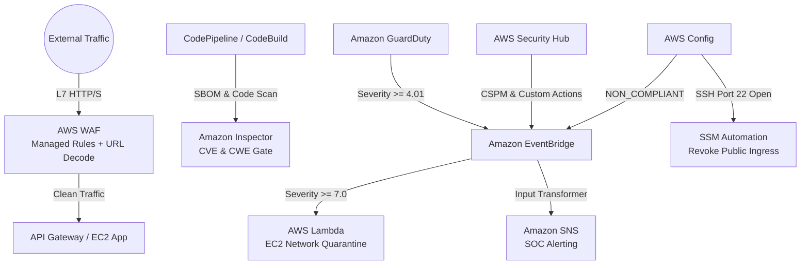

# 🛡️ Module 04: Foundational Security, Identity, and Governance

**Chief Cloud Architect:** MD Shafiqul Islam Shraban (`md-shafiq-cloud-architect`)  
**Domain:** Threat Detection, CSPM, DevSecOps CI/CD Gates, L7 WAF & Automated Incident Response  

---

## 🏗️ End-to-End Enterprise Security Architecture

This module implements defense-in-depth across threat detection (**GuardDuty**), centralized posture (**Security Hub**), compliance auto-remediation (**AWS Config + SSM**), shift-left scanning (**Amazon Inspector + CodeBuild**), and L7 edge protection (**AWS WAF**).

---

## ⚖️ Automated Remediation vs. Human-in-the-Loop Trade-Offs

| Security Scenario | Detection Engine | Response Strategy | Architectural Justification |
| :--- | :--- | :--- | :--- |
| **Unrestricted SSH (`0.0.0.0/0:22`)** | AWS Config Rule | **Auto-Revoke Ingress** (SSM) | Critical exposure; zero legitimate production impact when blocked. |
| **Compromised EC2 (`Severity >= 7.0`)** | GuardDuty + EventBridge | **Network Quarantine** (Lambda) | Preserves forensic disk/memory state without terminating the server. |
| **Missing S3 SSL Policy** | AWS Config Rule | **SNS Alert Only** (Human Review) | Prevents breaking legacy production pipelines from sudden policy changes. |
| **WAF Managed Rules Rollout** | AWS WAF | **Count Mode -> Block Mode** | Validates zero false positives against live traffic before enforcing HTTP 403. |
| **High/Critical Dependency CVE** | Inspector + CodeBuild | **Pipeline Gate Block** | Stops vulnerable packages (`urllib3==1.25.8`) before production deployment. |

---

## 🔍 Verified Artifacts

- **`04_foundational_security_governance.ipynb`**: Colab-verified Python validation suite covering IAM least-privilege & `iam:PassedToService` auditing, ASFF routing, Custom Action Input Transformation, CI/CD SBOM gating, AST static code scanning (`CWE-78`/`CWE-328`), and AWS WAF anti-evasion simulation.
- 
